<p align="center">
  
</p>

<p align="center">
  
</p>

<p align="center">
  <a href="https://www.linkedin.com/in/diosa-oliver/"></a>
  <a href="https://github.com/dioxaaa"></a>
  
  
</p>

## `> SELECT_PLAYER`

```text
+--------------------------------------------------------+
| PLAYER_1.EXE                                 [_][#][X] |
+--------------------------------------------------------+
|                                                        |
| NAME ............ Dio                                  |
| CLASS ........... Full-Stack Developer                 |
| HOME BASE ....... Philippines                          |
| LEVEL ........... always leveling up                   |
|                                                        |
| SPECIAL MOVES ... React, Node.js, TypeScript,          |
|                   API Integration, Debugging           |
| MAIN QUEST ...... build useful things for real people  |
| SIDE QUESTS ..... clean code, cute UI, zero chaos      |
|                                                        |
| > READY PLAYER ONE_                                    |
+--------------------------------------------------------+
```

I'm a developer who loves **problem solving, product thinking, and clean execution**. I build things that are useful, thoughtful, and easy to use, and I learn best by actually shipping them.

## `> INVENTORY`

<p align="center">
  
</p>

<p align="center">
  
  
  
  
  
</p>

## `> PROJECTS`

<sub><code>PINNED // CO-OP MODE</code> collaborations</sub>

<table>
  <tr>
    <td width="50%" valign="top">
      <sub><code>PINNED</code> <code>COLLABORATOR</code></sub>
      <h3><a href="https://github.com/EngrPrenz/Salo-sa-Antipolo">SALO SA ANTIPOLO</a></h3>
      <p>A restaurant management system with separate admin, cashier, and waiter portals. I worked on orders, billing, receipts, and responsive layouts.</p>
      
      
    </td>
    <td width="50%" valign="top">
      <sub><code>PINNED</code> <code>COLLABORATOR</code> <code>PRIVATE REPO</code></sub>
      <h3>URSTAMP</h3>
      <p>An event attendance app where attendees scan a QR code to time in and time out, with admin-set attendance windows.</p>
      
    </td>
  </tr>
</table>

<sub><code>SOLO MODE</code> my own repos</sub>

<table>
  <tr>
    <td width="33%" valign="top">
      <h3><a href="https://github.com/dioxaaa/Liham">LIHAM</a></h3>
      <p>A quiet digital time capsule. Write a letter today, pick the day it arrives, and it stays sealed until then.</p>
      
    </td>
    <td width="33%" valign="top">
      <h3><a href="https://github.com/dioxaaa/Kuryente-Watch-AppBuilder-Hackaton">KURYENTEWATCH</a></h3>
      <p>A local-first household energy companion: track appliances, meter readings, and bills, with an on-device AI assistant.</p>
      
      
    </td>
    <td width="33%" valign="top">
      <h3><a href="https://github.com/dioxaaa/Travel-Tie">TRAVELTIE</a></h3>
      <p>Plan the perfect trip with smart budgeting tools, 409 curated destinations, and live currency conversion.</p>
      
    </td>
  </tr>
</table>

## `> HIGH_SCORES`

<p align="center">
  
  
</p>

<p align="center">
  
</p>

## `> SAVE_FILE`

> *Good development is a balance of technical skill, thoughtful design, and continuous learning.*
> *I build things that are useful, clean, and intentional.*

<p align="center">
  
</p>

